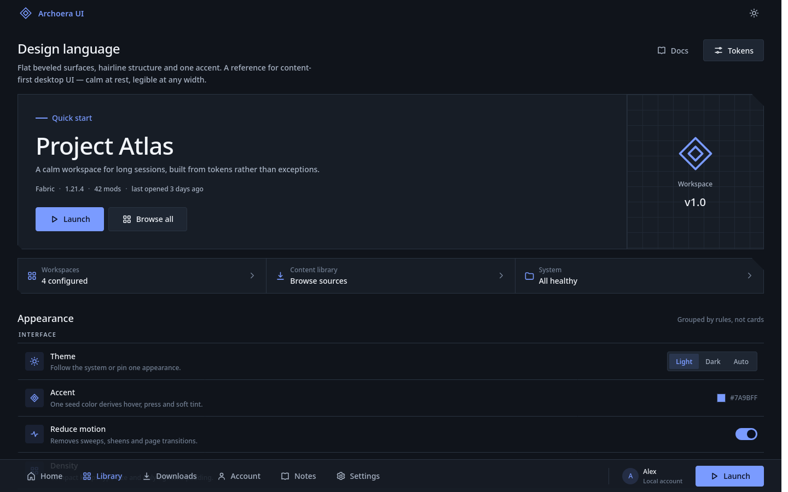

# ArchoeraCX UI Skill

面向 AI Agent 的可移植 UI 设计 Skill，提取自 **ArchoeraCX** 的界面视觉系统。

它不是组件库，也不是应用源码；它是一套可被 Agent 读取、审查和执行的设计规则，用来构建或改造干净、宽敞、层级明确、克制的桌面端界面。



## 这是什么

- 一个 `SKILL.md` 驱动的 Agent Skill，包含布局、组件、颜色、字体、动效和页面模式。
- 框架无关：可映射到 Web、Flutter、Qt/QML、Compose、SwiftUI 等栈。
- 主题完整：默认浅色，同时提供深色 token 和深色预览。
- 纯静态预览：HTML/CSS/少量原生 JavaScript，无构建步骤、无外部依赖、无网络请求。

## 设计语言

**层级来自细线、留白和背景层级，而不是圆角卡片、重阴影或装饰。**

- **Flat / beveled**：页面区块保持透明、直角，用 1 px 上下分隔线；面板使用 `8 / 14 / 22` 的斜切角（bevel）作为识别特征，按钮只保留 `2–4 px` 圆角。
- **Token-only**：颜色、字体、间距、圆角、时长全部来自 token；页面里不写死视觉值。
- **单强调色**：默认 `#4F7CFF`（浅色）/ `#7A9BFF`（深色）；悬停、按下、柔和底色都从同一 seed 派生。
- **桌面壳**：顶部栏 `48`，底部命令栏 `60`（首页画布 `46`），内容 gutter `32`，全宽内容上限 `2880`。
- **克制动效**：`120 / 180 / 240 ms`，统一 `easeOutCubic`；只做透明度和位移动画，不做弹跳、缩放或动画中的布局变化。
- **可访问**：正文对比度 ≥ 4.5:1；每个图标按钮都有 tooltip 和可访问名称；支持 reduced motion。

典型字体层级：

```text
display   32 / 40
title1    24 / 32
title2    18 / 26
body      14 / 22
bodyStrong 14 / 22 · 600
caption   12 / 18
overline  11 / 16 · 600 · 0.6
```

默认字重是 **500**；层级主要靠字号、颜色和留白建立，而不是一味加粗。

## 目录

```text
.
├── SKILL.md                 # 技能入口：使用场景、原则、工作流、检查清单
├── README.md
├── LICENSE                  # AGPL-3.0
├── NOTICE.md                # 来源、署名与素材边界
├── references/
│   ├── tokens.md            # 颜色、字体、间距、圆角、边框、对比度
│   ├── layout.md            # 窗口结构、尺寸、断点、页面布局
│   ├── components.md        # 按钮、区块、面板、列表、菜单、弹窗、Toast
│   ├── motion.md            # 时长、曲线、转场、骨架屏、性能
│   └── patterns.md          # 页面原型、状态、文案、可访问性、审查表
└── assets/
    ├── tokens.json          # 机器可读 token
    ├── tokens.css           # CSS 自定义属性和基础配方
    ├── preview.html         # 可交互视觉参考页
    └── preview-dark.png     # README 预览图
```

仓库根目录就是技能目录，`SKILL.md` 是唯一入口。Agent 只在需要时读取 `references/` 和 `assets/`。

## 快速开始

### 在 Agent 中使用

1. 获取仓库：

   ```bash
   git clone https://github.com/ArchoeraC/ArchoeraCX-UI.git archoera-ui
   ```

2. 将包含 `SKILL.md` 的整个文件夹放入你的 Agent Skill 目录。
   如果工具要求固定目录名，使用 `archoera-ui`。

3. 在任务里明确调用，例如：

   ```text
   使用 archoera-ui skill 设计一个设置页：
   左侧分区导航，右侧设置区块，使用细线分隔和 bevel 面板。
   ```

   ```text
   按 archoera-ui 的规则审查这个界面：
   重点看层级、对比度、动效和空状态。
   ```

### 查看预览

无需安装依赖，直接打开：

```text
assets/preview.html
```

或启动一个本地静态服务器：

```bash
cd assets
python3 -m http.server 8000
# http://localhost:8000/preview.html
```

深色预览：

```text
assets/preview.html?theme=dark
```

预览包含浅色/深色切换、导航、hero、设置区块、命令栏和基础交互，用来校准视觉而不是示范业务实现。

## 适用场景

- 新建桌面应用的页面、窗口壳、设置页、列表、详情页或对话框。
- 为产品定义颜色、字体、间距和动效 token。
- 审查现有界面的层级、密度、状态和可访问性。
- 把同一套视觉语言移植到其他前端/客户端技术栈。

## 不适用范围

- 不提供业务逻辑、接口、数据模型、架构或后端方案。
- 不复制第三方产品的具体布局、插画、图标字体、截图或品牌素材。
- 不把业务规则塞进 UI 规范；UI 只负责呈现和交互状态。

## 来源、署名与许可证

- 设计来源：**ArchoeraCX** UI 设计系统（上游文档采用 **AGPL-3.0**）。
- 本仓库是对该视觉系统的独立重述与工程化整理，不包含 ArchoeraCX 的应用源码、字体、图标字体、插画或界面截图。
- 预览页的界面、SVG 图标和 CSS 渐变均为本仓库自制内容。
- 本仓库以 **AGPL-3.0-or-later** 发布，详见 [`LICENSE`](LICENSE)；引用或再分发时请保留来源署名，详见 [`NOTICE.md`](NOTICE.md)。

---

维护：ArchoeraC · Skill version `1.0.0`
